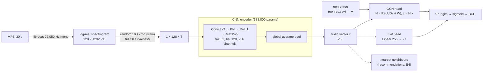

# tiny-timbre

Multi-label genre tagging on FMA-medium: a CNN trained from scratch listens to a 30 s clip and
predicts its full set of genre tags. We test whether a graph convolution (GCN) over FMA's genre
hierarchy beats an identical flat multi-label head, especially for rare and fine-grained genres,
and use the learned embeddings for a nearest-neighbour recommendation prototype.

## Setup

```bash
uv sync                 # installs pinned deps from uv.lock
uv run pytest -q        # all tests use small fake data; no dataset needed
```

## Data

1. Download `fma_metadata.zip` and `fma_medium.zip` from <https://github.com/mdeff/fma> and unzip
   both into one folder (e.g. `data/`), giving `data/fma_metadata/` and `data/fma_medium/`.
   SHA-1 of `fma_medium.zip`: `c67b69ea232021025fca9231fc1c7c1a063ab50b`.
2. Cache log-mel spectrograms (CPU, once; about 2 h on free Colab, resumable):

   ```bash
   uv run python -m tiny_timbre.data --data-dir data --out-dir data/mels_medium
   ```

   Output: `logmel_f16.npy` of shape (25000, 128, 1292) float16 (8.27 GB), plus `index.csv`
   mapping each row to `track_id` and a `status` (24,985 ok, 15 failed to decode).
   The team copy lives on Drive at `dl-final/data/mels_medium`. Colab runner:
   `notebooks/spectrograms.ipynb`.

## Architecture



## Reproducing results

Three commands, once the data is in `data/` (see Data above):

```bash
uv sync
uv run python -m tiny_timbre.baseline --config configs/e0_baseline.yaml     # E0 logistic regression (CPU)
uv run python -m tiny_timbre.train --config configs/e1_gcn_s0.yaml          # any CNN run (GPU)
```

Each training run logs loss, validation macro mAP and per-layer gradient norms to Weights & Biases
every epoch, keeps the epoch with the best validation score, then scores the test split and saves
`data/results/<name>_test_scores.npz` and `<name>_embeddings.npz` (song vectors for E4). Interrupted
runs resume from `checkpoints/<name>.pt`. On Colab, use `notebooks/train_colab.ipynb`.

| Config | Experiment |
|---|---|
| `configs/sanity.yaml` | 1,000 clips, 3 epochs: check the loss goes down |
| `configs/e0_baseline.yaml` | E0: logistic regression on `features.csv` |
| `configs/e0_cnn_flat.yaml` | E0: CNN + flat head; also E1's flat run for seed 0 |
| `configs/e1_flat_s1.yaml`, `e1_flat_s2.yaml` | E1: flat head, seeds 1 and 2 |
| `configs/e1_gcn_s0.yaml`, `e1_gcn_s1.yaml`, `e1_gcn_s2.yaml` | E1: GCN head over the genre tree, seeds 0–2 |
| `configs/e2_gcn_cooc_s0.yaml` | E2: tree + co-occurrence edges (compare with `e1_gcn_s0`) |
| `configs/e3_gcn_1layer_s0.yaml`, `e3_gcn_3layer_s0.yaml` | E3: GCN depth 1 and 3 (2 layers is `e1_gcn_s0`) |

_TODO: results table, links to the W&B runs, peak GPU memory and the machine the reported results were run on._

## Recommendation demo

A local web page for trying the recommendation prototype (E4) by ear: pick a test song, listen
to it, and compare its 10 nearest songs under the GCN model's embeddings, the flat model's
embeddings and `features.csv`, side by side. It uses the same search and score as E4
(`recommend.py`), and also shows genre overlap@10 over the whole test split.

```bash
# needs data/results/e1_gcn_s0_embeddings.npz and/or e0_cnn_flat_embeddings.npz (from Drive's results/)
uv run --group demo python -m tiny_timbre.demo              # opens in the browser
uv run --group demo python -m tiny_timbre.demo --prefetch   # first cache the clips for the ★ demo songs
```

Clips play from `data/fma_medium/` if present; otherwise each one (~1 MB) is fetched on demand
from the public `fma_medium.zip` and cached in `data/demo_audio/`. After `--prefetch`, the ★ songs
(one per top-level genre) work offline. `--share` gives a temporary public link.

**Built by Claude Code (AI)** at the team's request, as a presentation aid. It is not part of
the graded method; see AI usage below.

## AI usage

| What | Tool | How it was used |
|---|---|---|
| `src/tiny_timbre/demo.py`, `tests/test_demo.py` (recommendation demo) | Claude Code | written entirely by the AI at Maddi's request; uses Miranda's `recommend.py` for the search and score |

_TODO: the rest of the AI usage log (every member); conversation exports in `transcripts/`._

## Repository layout

```
tiny-timbre/
├── pyproject.toml        # uv project; deps: torch, librosa, soundfile, pandas, scikit-learn, wandb, pyyaml, tqdm, matplotlib
│                         # dev deps: pytest, ipykernel, torch_geometric (only for checking our GCN); demo group: gradio
├── uv.lock
├── README.md             # how to get the data + reproduce every result
├── HYPOTHESES.md         # predictions, committed before each experiment runs
├── configs/              # default.yaml (data_dir) + one YAML per experiment
├── src/tiny_timbre/
│   ├── data.py           # tracks.csv loading, log-mel caching [Maddi]; Dataset + crops  [Miranda]
│   ├── baseline.py       # one-vs-rest logistic regression on features.csv               [Ayesha]
│   ├── encoder.py        # CNN: spectrogram -> 256-d audio vector                        [Maddi]
│   ├── labels.py         # label matrix Y from genres_all, ancestor check, genre filter  [Miranda]
│   ├── graph.py          # adjacency A from genres.csv, co-occurrence, normalized       [Miranda]
│   ├── gcn.py            # from-scratch GCN layer + GCN head; flat head                  [Ayesha]
│   ├── model.py          # encoder + head wired together                                 [Maddi]
│   ├── train.py          # training loop, W&B logging, best epoch, test scoring          [Maddi]
│   ├── evaluate.py       # macro mAP, per-level mAP, hierarchy violations, audit list    [Miranda]
│   ├── recommend.py      # nearest-neighbour recommendations + genre overlap@k           [Miranda]
│   ├── analyze.py        # result tables, seed averages, over-smoothing, audit, figures  [Maddi]
│   └── demo.py           # web page for trying the recommendations by ear      [Claude Code, AI]
├── tests/
│   ├── test_data.py      # log-mel shapes, padding, resume, failed clips                 [Maddi]
│   ├── test_gcn.py       # matches PyG GCNConv, gradcheck                                [Ayesha]
│   ├── test_graph.py     # Â symmetric, eigenvalues in [-1, 1], every genre has a parent  [Miranda]
│   ├── test_labels.py    # parents included, no tags in the inputs                       [Miranda]
│   ├── test_encoder.py   # output shape, parameter count ≈ 0.39M                         [Maddi]
│   └── test_recommend.py # neighbours and overlap@k on fake embeddings                   [Miranda]
├── notebooks/            # Colab runners (train_colab, spectrograms) + figures; no logic here
├── data/                 # gitignored: raw MP3s, cached mels, checkpoints
└── report/               # report + figures
```
